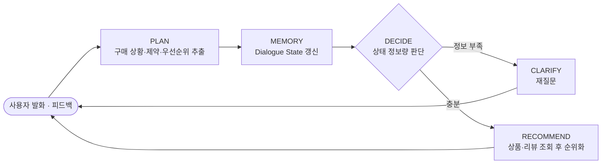

<div align="center">

# 사용자 요구 변화를 추적하는 다중 턴 쇼핑 에이전트

*A Multi-turn Shopping Agent that Tracks Evolving User Needs*

김진욱<sup>1</sup> · 노태형<sup>2</sup> · 여해인<sup>2</sup> · 한경식<sup>1,2</sup>

<sup>1</sup>Department of Data Science, Hanyang University · <sup>2</sup>Department of Artificial Intelligence, Hanyang University

한국데이터마이닝학회(KDMS) 포스터 발표

[**Poster (PDF)**](<presentation/김진욱_사용자 요구 변화를 추적하는 다중 턴 쇼핑 에이전트.pdf>) ·
[**Mock Demo**](https://agent-iota-five.vercel.app/) ·
[**설계 문서**](flow.md) ·
[**실행 방법**](backend/README.md)

</div>

---

## TL;DR

대화가 진행되면서 바뀌는 사용자의 조건·거절·우선순위를 **Dialogue State**로 누적하고, 이 상태를
질의 생성과 상품 재순위화에 반영하는 **상태 기반 쇼핑 에이전트**를 제안한다.
태블릿 구매 시나리오 20개(81턴)에서 측정한 결과는 다음과 같다.

- **상태를 유지하면 누적된 요구를 더 잘 보존한다.** Final State F1 0.500 → **0.758** (+0.258)
- **대신 턴별 변화 추적은 나빠진다.** 이전 상태를 새 정보로 중복 인식해 State Diff F1 0.700 → **0.562** (−0.138)
- **리뷰는 실제 순위를 바꾼다.** 리뷰 점수를 제거하면 Top-1 추천이 **55.6%**, Top-3 순서가 **87.3%** 바뀐다.
- **병목은 상태 추론이다.** 추론한 상태를 정답 상태로 바꾸면 Policy·Reach·Hard-filter가 모두 **1.0**으로 회복된다.

<p align="center">
  <a href="presentation/김진욱_사용자%20요구%20변화를%20추적하는%20다중%20턴%20쇼핑%20에이전트.pdf">
    
  </a>
  <br>
  <sub>이미지를 누르면 포스터 PDF가 열린다.</sub>
</p>

## 1. 배경

추천 시스템은 사용자 프로필과 과거 상호작용으로 선호를 추론해 왔다. 하지만 고정된 로그에서 다음
아이템을 예측하는 방식으로는 실제 쇼핑 중에 생기는 다음 정보를 반영하기 어렵다.

- 대화하면서 바뀌는 요구와 우선순위
- 특정 상품을 거절한 이유
- 재고·가격·배송처럼 지금 이 순간의 정보
- 여러 턴에 걸친 대화 맥락

예를 들어 최고가 모델을 산 기록은 "고가 라인업 선호"처럼 보이지만, 실제로는 쓰던 기기가 고장 나
**당장 받을 수 있는 재고**를 고른 결과일 수 있다. 구매 결과만으로는 지속적인 선호와 구매 시점의
상황적 제약을 구분할 수 없다.

기존 쇼핑 에이전트(Agent N)를 직접 사용해 보면서도 같은 한계를 확인했다. 대화가 이어져도 후보가
충분히 좁혀지지 않았고, 요구가 모호한데도 핵심 조건을 묻지 않고 바로 추천했으며, 왜 이 후보를 남기고
다른 후보를 뺐는지, 피드백으로 무엇이 바뀌었는지 설명하지 못했다.

그래서 이 연구는 **Dynamic State Grounding**을 제안한다. 대화 중 나온 조건과 추천·거절·수락 이력을
Dialogue State에 계속 누적하고, 이를 질의 생성과 재순위화에 반영해 사용자의 의도를 추적한다.

<details>
<summary><b>왜 전통적인 추천 모델을 중심에 두지 않았나</b></summary>

<br>

전통적인 추천 방식을 부정한 것이 아니라, 이 연구의 데이터와 평가 질문에 맞지 않았다.

1. **구매 결과와 지속 선호를 구분할 수 없다.** 다음 아이템 예측만으로는 구매 당시의 상황, 거절
   이유, 턴별 우선순위 변화를 복원하기 어렵다.
2. **필요한 정답 데이터가 없다.** Amazon Reviews 2023은 상품·리뷰 근거를 제공하지만 질의별 적합
   상품, 턴별 Dialogue State·State Diff, 재질문/추천 행동의 정답은 없다. ESCI도 검색 관련성 평가에는
   쓸 수 있지만 다중 턴 대화 상태와 연결된 정답은 아니다.
3. **실험 목적과 맞지 않는다.** 직접 만든 20개·81턴 시나리오는 memory 유무에 따른 상태 보존을
   평가하기 위한 동결 holdout이지, 추천 모델을 학습시킬 사용자–아이템 행동 데이터가 아니다.

그래서 LLM은 발화 이해와 응답 작성에만 쓰고, 상태 병합·정책·hard filter·질의 생성·랭킹은 결정론적
코드로 고정했다. 자세한 근거는 [`manual.md`](manual.md)와
[Agent N 사용 경험 분석](<presentation/Summer_Intern_에이전트N_사용경험_진욱.pptx>)에 있다.

</details>

## 2. 방법



| 단계 | 하는 일 | 구현 |
| --- | --- | --- |
| **PLAN** | 사용자 발화와 대화 맥락에서 구매 상황, 제약, 우선순위를 구조화해 추출 | LLM (GPT-4o-mini, JSON schema) |
| **MEMORY** | 추출 결과를 Dialogue State에 병합하고 턴별 변화(State Diff)를 기록 | 결정론적 코드 |
| **DECIDE** | 상태 정보량을 보고 재질문할지 추천할지 결정 | 결정론적 코드 |
| **CLARIFY** | 부족한 핵심 조건을 되묻기 | 응답 문장만 LLM |
| **RECOMMEND** | 상태로 질의 생성 → 상품 조회(hard filter) → 리뷰 검색(Bi-encoder + Cross-Encoder) → 랭킹 | 검색·랭킹은 결정론적, 응답 문장만 LLM |

포스터에 실린 예시 대화는 다음과 같다. 각 상태 항목에는 출처(`origin`), 확신도(`confidence`),
확인 여부(`status`)와 근거 턴이 함께 기록된다.

```text
[User]       쓰던 아이폰이 고장 나서 새로 바꿔야 해요.
[PLAN]       softConstraints.urgencyPressure = "지금 쓸 기기가 없어 수령 대기에 민감할 가능성"
             (origin: inferred, confidence: 0.64, status: unconfirmed)
[MEMORY]     + category  + subjectiveNeeds.event  + subjectiveNeeds.goal_purpose
             + softConstraints.urgencyPressure
[CLARIFY]    예산은 어느 정도로 생각하고 계신가요?
[User]       150만 원 정도 생각하는데, 오래 쓸 거라 더 비싸도 돼요.
[RECOMMEND]  iPhone 17 256GB 추천 · 1,290,000원 · 무료배송 · 약 2주 후 수령
[User]       폰이 고장 난 상태라서 2주 동안 기다리기는 어려울 것 같아요.
             → 피드백을 다시 상태에 반영하고 추천 순위를 재조정
```

> 위 예시는 설명용 스마트폰 시나리오다. 정량 평가는 모두 태블릿 도메인에서 수행했다.

## 3. 실험 설정

- **데이터:** Amazon Reviews 2023에서 추출한 태블릿 117개, 리뷰 7,552개
- **시나리오:** 태블릿 구매를 가정한 독립 다중 턴 시나리오 20개(총 81턴), 사전에 동결한 holdout
- **비교 조건:** **Full**(이전 Dialogue State를 다음 턴까지 유지) vs **No-memory**(현재 턴 정보만 사용)
- **통계:** 시나리오 단위 paired bootstrap 10,000회, 95% CI

## 4. 결과

### Main Experiment: Full vs No-memory

| Metric | Full | No-memory | Difference | 95% bootstrap CI |
| --- | ---: | ---: | ---: | :---: |
| Final State micro-F1 | **0.758** | 0.500 | **+0.258** | [+0.172, +0.334] |
| State Diff micro-F1 | 0.562 | **0.700** | **−0.138** | [−0.222, −0.056] |
| Policy accuracy | 0.802 | 0.741 | +0.062 | [−0.111, +0.222] |
| Recommendation reach | 0.808 | 0.744 | +0.064 | [−0.103, +0.231] |
| Hard-filter completion | 0.630 | 0.444 | +0.185 | [+0.000, +0.363] |

- 이전 상태를 유지하면 대화 종료 시점의 상태가 정답에 더 가깝다(Final State F1 +0.258).
- 반면 이전 상태를 현재 턴의 새 정보로 다시 인식하는 경우가 생겨 턴별 변화 추적은 떨어진다(State Diff F1 −0.138).
- Policy·Reach·Hard-filter는 평균적으로 Full이 높지만, 95% CI가 0을 포함하거나 경계에 걸쳐 있다.

### Diagnostic Analysis

<table>
<tr>
<td valign="top" width="50%">

**(a) Gold-State 대체를 통한 오류 원인 진단**

| Metric | Actual Full | Gold-State | Recovery |
| --- | ---: | ---: | ---: |
| Policy | 0.802 | 1.000 | +0.198 |
| Reach | 0.808 | 1.000 | +0.192 |
| Hard-filter | 0.630 | 1.000 | +0.370 |

추론한 Dialogue State를 정답 상태로 바꾸면 세 지표가 모두 1.0으로 회복된다. 즉 주요 손실은
정책·검색 단계가 아니라 **상태 추론·구성 단계**에서 발생한다.

</td>
<td valign="top" width="50%">

**(b) 리뷰 정보의 순위 기여도 분석**

| Ranking behavior | Result |
| --- | ---: |
| Top-1 changed | 55.6% |
| Top-3 order changed | 87.3% |
| Mean top-3 Jaccard | 0.522 |

Full의 상태·질의·후보를 그대로 두고 리뷰 점수만 제거했을 때 순위가 크게 달라진다. 리뷰가 실제
순위 결정에 기여하고 있다는 뜻이다.

</td>
</tr>
</table>

**해석할 때 주의할 점**

- (b)의 순위 변화는 리뷰의 *기여*를 보여줄 뿐이다. 사람이 매긴 relevance label이 없으므로 추천
  *품질이 좋아졌다*는 뜻은 아니다.
- (a)는 평가기 쪽에서 정답 상태를 주입한 결정론적 상한(upper bound) 진단이며, end-to-end 성능이 아니다.
- 지표 정의는 [`tablet_domain_automatic_metric_definitions.md`](backend/docs/tablet_domain_automatic_metric_definitions.md)에 있다.

## 5. 결론과 향후 과제

Dialogue State를 지속적으로 관리하면 누적된 사용자 요구를 더 잘 보존할 수 있고, 리뷰 정보는 실제
상품 순위에 영향을 준다. 주요 성능 손실은 상태 추론·구성 과정에서 발생한다.

앞으로는 다음을 검증하려 한다.

- 과거 상태와 현재 턴의 변화를 더 정확히 구분하는 상태 추론·갱신 방식
- 리뷰로 달라진 순위가 실제 추천 정확도와 사용자가 느끼는 추천 품질 향상으로 이어지는지
- 가격·재고·배송 같은 동적 정보와 다양한 상품군을 포함한 더 현실적인 쇼핑 환경

---

## 저장소 안내

이 저장소는 2026년 하계 인턴 연구(2026.06.23 – 2026.08.26)의 공개본이다. 내부 코드명은
**KDMS SPN + RA-Rec**으로, SPN(발화 이해·정책·탐색·응답)과 RA-Rec(상태 관리·질의 생성·랭킹)의
설계를 하나의 LangGraph workflow로 결합했다.

| 경로 | 내용 |
| --- | --- |
| [`backend/`](backend/) | LangGraph workflow, FastAPI API·UI, 평가기와 동결 fixture |
| [`presentation/`](presentation/) | 중간 점검부터 최종 발표·포스터까지의 발표 자료(PPTX/PDF) |
| [`flow.md`](flow.md) | 아키텍처, 상태 계약, 실험 결과의 정본 |
| [`manual.md`](manual.md) | 기술과 데이터 선택 근거 |
| [`PROGRESS.md`](PROGRESS.md) | 구현 현황과 남은 작업 |
| [`DATA_AND_PRIVACY.md`](DATA_AND_PRIVACY.md) | 공개 데이터와 개인정보 경계 |

> **Mock Demo 안내:** [agent-iota-five.vercel.app](https://agent-iota-five.vercel.app/)은 스마트폰 교체
> 상담 흐름을 고정된 mock 데이터로 보여주는 초기 UI 목업이다. 이 저장소의 실데이터 백엔드와 평가
> 결과와는 별개다.

### 빠른 시작

API 키와 실데이터 없이 mock provider로 synthetic 6턴 경로를 실행할 수 있다.

**Windows (PowerShell)**

```powershell
cd backend
python -m venv .venv
.\.venv\Scripts\python.exe -m pip install -r requirements.txt
$env:LLM_PROVIDER="mock"
.\.venv\Scripts\python.exe -m uvicorn app.api:app --reload
```

**macOS / Linux**

```bash
cd backend
python3 -m venv .venv
.venv/bin/pip install -r requirements.txt
LLM_PROVIDER=mock .venv/bin/python -m uvicorn app.api:app --reload
```

브라우저에서 `http://127.0.0.1:8000`을 연다. Python 3.12 기준으로 고정된 의존성이다.
Luxia LLM과 실제 태블릿 catalog를 쓰는 경로는 API 키, Amazon Reviews 2023 가공 데이터와 semantic
index가 별도로 필요하며 저장소에는 포함되어 있지 않다. 자세한 내용은 [`backend/README.md`](backend/README.md)를 참고한다.

### 연구 브랜치

| 브랜치 | 질문 | 결론 |
| --- | --- | --- |
| `main` | memory가 다중 턴 상태와 추천에 어떤 영향을 주는가 | v2.3 기준선과 official automatic benchmark (포스터 결과) |
| `exp/0-intent-extraction` | 상태만으로 숨은 의도 가설을 만들 수 있는가 | 정성적 탐색 실험이며 정확도 주장은 아님 |
| `exp/1-state-diff-strategies` | 반복·거짓 State Diff를 어떻게 줄이는가 | semantic no-op suppression으로 State Diff는 개선, Final State는 동일 |
| `exp/2-segse-final-state` | sparse grounded event로 누적 상태를 고칠 수 있는가 | 개발 세트에서는 개선됐지만 사전에 동결한 confirmatory 판정 기준은 통과하지 못함 |

전체 실험 흐름은 `exp/2-segse-final-state` 브랜치의
[`experiments.md`](https://github.com/ApeachLicense/Shopping_Agent_with_DST_KDMS_Puplic/blob/exp/2-segse-final-state/experiments.md)에
정리되어 있다. 로컬 clone에서는 다음처럼 볼 수 있다.

```bash
git fetch origin exp/2-segse-final-state
git show FETCH_HEAD:experiments.md
```

결과를 해석할 때 개발 세트, post-hoc 분석, official holdout, confirmatory 결과를 섞지 않는다.
SEGSE v1.4는 confirmatory 실패 이후 수정하지 않았으며, 남은 핵심 오류는 semantic dimension attribution이다.

### 평가와 재현

- Primary automatic 결과: [`tablet_domain_automatic_benchmark_v1.md`](backend/docs/tablet_domain_automatic_benchmark_v1.md)
- Metric 정의: [`tablet_domain_automatic_metric_definitions.md`](backend/docs/tablet_domain_automatic_metric_definitions.md)
- Official 실행 기록: [`tablet_domain_holdout_official_run.md`](backend/docs/tablet_domain_holdout_official_run.md)
- 실데이터 가공: [`backend/data/README.md`](backend/data/README.md)

동결된 holdout·manifest·공식 결과는 보고된 수치를 개선하기 위해 사후 수정하지 않는다. 이 공개본은
원본 연구 저장소의 브랜치 tip을 새 Git 이력으로 옮긴 것이며, 대응 commit과 제외 항목은
[`PUBLIC_RELEASE_MANIFEST.json`](PUBLIC_RELEASE_MANIFEST.json)에 기록되어 있다.

### 공개 범위

원본 리뷰 corpus, LLM trace, episode 감사 로그, 로컬 model/index와 자격 증명은 포함하지 않는다.
`presentation/`에는 개발 과정을 설명하기 위해 선별한 발표 자료만 둔다. 기여와 보안 정책은 각각
[`CONTRIBUTING.md`](CONTRIBUTING.md)와 [`SECURITY.md`](SECURITY.md)를 따른다.

## Acknowledgement

이 논문은 정부(교육부)의 재원으로 한국산업기술진흥원의 지원(P0030395, 첨단산업인재양성부트캠프)과
2026 정부(과학기술정보통신부)의 지원을 받아 수행된 연구임(RS-2026-25490215).
