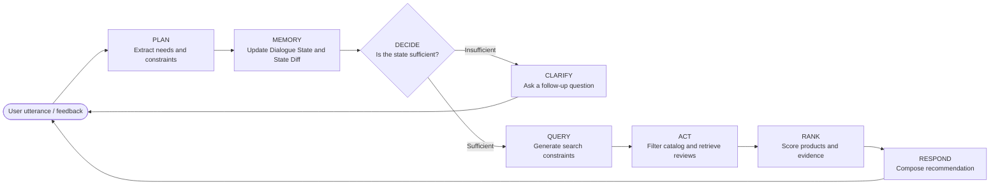

<div align="center">

# A Multi-turn Shopping Agent that Tracks Evolving User Needs

**Dynamic State Grounding for Conversational Recommendation**

김진욱<sup>1</sup> · 노태형<sup>2</sup> · 여해인<sup>2</sup> · 한경식<sup>1,2</sup>

<sup>1</sup>Department of Data Science, Hanyang University · <sup>2</sup>Department of Artificial Intelligence, Hanyang University

Poster presentation at the Korea Data Mining Society (KDMS)

[**한국어**](README.md) · **English**

[**Poster (PDF)**](<presentation/김진욱_사용자 요구 변화를 추적하는 다중 턴 쇼핑 에이전트.pdf>) ·
[**Mock Demo**](https://agent-iota-five.vercel.app/) ·
[**Architecture**](flow.md) ·
[**Setup Guide**](backend/README.md)

</div>

---

## TL;DR

We propose a stateful shopping agent that tracks evolving user constraints, preferences, rejections, and priorities across conversation turns. Rather than treating each utterance as an isolated search query, the agent maintains an explicit **Dialogue State** and uses it to ground query generation and product reranking.

On a frozen holdout of 20 tablet-shopping scenarios (81 turns):

- **Persistent memory improves cumulative state retention:** Final State micro-F1 increases from 0.500 to **0.758** (+0.258).
- **However, memory introduces a turn-level tracking trade-off:** State Diff micro-F1 decreases from 0.700 to **0.562** (−0.138), partly because previously extracted information is mistakenly treated as new information.
- **Review evidence affects ranking:** removing the review contribution while holding upstream outputs fixed changes the top-1 recommendation in **55.6%** of recommendation turns and the top-3 ordering in **87.3%**.
- **State inference is the main observed bottleneck:** substituting gold dialogue states in an evaluator-side diagnostic restores policy accuracy, recommendation reach, and hard-filter completion to **1.000**.

<p align="center">
  <a href="presentation/김진욱_사용자%20요구%20변화를%20추적하는%20다중%20턴%20쇼핑%20에이전트.pdf">
    
  </a>
  <br>
  <sub>Click the image to open the poster PDF (Korean).</sub>
</p>

## 1. Motivation

Traditional recommender systems infer user preferences from profiles and historical interactions. However, predicting the next item from static interaction logs does not directly capture several important aspects of real shopping conversations:

- Requirements and priorities that evolve across turns.
- Reasons for rejecting a particular recommendation.
- Context-dependent constraints such as stock availability, price, and delivery time.
- Conversational context accumulated over multiple interactions.

For example, purchasing a premium smartphone may appear to indicate a persistent preference for premium models. In reality, the user's previous phone may have broken, and the premium model may simply have been the only one available for immediate pickup. The purchase outcome alone cannot distinguish a lasting preference from a temporary situational constraint.

Our exploratory use of an existing shopping agent (Agent N) also motivated this work: the candidate set did not narrow sufficiently across turns, essential clarification questions were sometimes skipped, and the reasons behind candidate selection and changes following feedback were not always apparent. These observations motivate the design rather than establish a general comparative performance claim.

We therefore propose **Dynamic State Grounding**: continuously recording user requirements and feedback in a structured Dialogue State and explicitly grounding subsequent retrieval and ranking decisions in that state.

<details>
<summary><b>Why not center the study on a conventional recommendation model?</b></summary>

<br>

The choice reflects the research question and available supervision, not a rejection of conventional recommender systems.

1. Next-item prediction alone cannot recover the situational constraints, rejection reasons, or priority changes that led to a purchase.
2. Amazon Reviews 2023 supplies product metadata and review evidence, but does not supply gold turn-level dialogue states, state changes, or clarification/recommendation actions. Amazon ESCI offers search relevance labels, not aligned multi-turn dialogue annotations.
3. The 20-scenario, 81-turn holdout was designed to evaluate state retention under different memory conditions, not to train a user–item interaction model.

The evaluated pipeline therefore uses an LLM for utterance understanding and response composition, while state merging, policy routing, query generation, filtering, retrieval, and ranking follow explicit code paths.

See [technical rationale](manual.md) and [Agent N exploratory analysis](<presentation/Summer_Intern_에이전트N_사용경험_진욱.pptx>) for details.

</details>

## 2. Method

The implementation combines SPN (understanding, policy, browsing, and response composition) with RA-Rec (state management, query generation, and ranking) in a single stateful LangGraph workflow.



| Stage | Responsibility | Implementation |
| --- | --- | --- |
| **PLAN** | Extract structured update candidates from the utterance and available dialogue context | GPT-4o-mini via Luxia, strict JSON schema |
| **MEMORY** | Merge candidates into the Dialogue State and record turn-level changes | Deterministic State Manager |
| **DECIDE** | Choose between clarification and recommendation using the current state | Deterministic policy |
| **CLARIFY** | Ask about missing essential information | LLM response composition |
| **QUERY / ACT** | Generate queries, filter products by hard constraints, and retrieve relevant reviews | Deterministic query and retrieval pipeline |
| **RANK / RESPOND** | Rank candidates using structured attributes and review evidence, then explain recommendations | Deterministic ranking; LLM response composition |

### Dialogue State Tracking

The state is updated after every user utterance. It distinguishes hard constraints, soft preferences, subjective needs, priorities, and item-level feedback. State entries can carry provenance, origin, confidence, confirmation status, and supporting evidence turns.

A versioned canonical vocabulary constrains identifiers, and the State Manager explicitly handles state transitions and State Diff. Unconfirmed inferences are not used as ranking signals. Inspecting a product is also distinguished from purchasing it, and situational rejection reasons are kept separate from product-attribute rejection reasons.

An illustrative smartphone conversation:

```text
[User]       My old iPhone broke, so I need a replacement.
[PLAN]       softConstraints.urgencyPressure = "May be sensitive to delivery delays"
             (origin: inferred, confidence: 0.64, status: unconfirmed)
[MEMORY]     + category  + subjectiveNeeds.event  + subjectiveNeeds.goal_purpose
             + softConstraints.urgencyPressure
[CLARIFY]    What is your approximate budget?
[User]       Around KRW 1.5 million, but I can pay more for long-term use.
[RECOMMEND]  iPhone 17 256 GB · KRW 1,290,000 · free shipping · delivery in about 2 weeks
[User]       My phone is broken, so waiting two weeks would be difficult.
             → Incorporate feedback into the state and adjust the recommendations.
```

> This smartphone example illustrates the intended design. All primary quantitative experiments were conducted in the tablet domain. Latent subjective-need generation was disabled in the frozen tablet-domain v2.3 evaluation, and live stock and delivery data are not implemented in that real-data pipeline.

### Technology Stack

| Component | Technology |
| --- | --- |
| Workflow orchestration | LangGraph |
| Backend and local UI | Python 3.12, FastAPI, Uvicorn |
| Structured LLM interface | Luxia GPT-4o-mini, Pydantic, strict JSON schema |
| Product catalog | Amazon Reviews 2023, DuckDB, Parquet |
| Review retrieval | Sentence Transformers bi-encoder, Cross-Encoder reranking |
| Evaluation | Frozen fixtures, deterministic evaluation, paired scenario bootstrap |

See [flow.md](flow.md) for the architecture and state contracts.

## 3. Experimental Setup

| Component | Setting |
| --- | --- |
| Catalog | 117 tablets from Amazon Reviews 2023 |
| Review corpus | 7,552 deduplicated reviews |
| Evaluation set | 20 independently constructed tablet-shopping scenarios, 81 turns |
| Full | Persistent Dialogue State with review evidence |
| No-memory | Current-turn information only, with review evidence |
| Statistical analysis | 10,000 paired bootstrap resamples at the scenario level; 95% confidence intervals |

The holdout was frozen before the first official system run. All 81 gold turns are included in the end-to-end evaluation; missing outputs following schema failures are counted as failures. The benchmark measures process-level fidelity rather than human-rated recommendation relevance.

## 4. Results

### Main Experiment: Full vs No-memory

| Metric | Full | No-memory | Difference | 95% bootstrap CI |
| --- | ---: | ---: | ---: | :---: |
| Final State micro-F1 | **0.758** | 0.500 | **+0.258** | [+0.172, +0.334] |
| State Diff micro-F1 | 0.562 | **0.700** | **−0.138** | [−0.222, −0.056] |
| Policy accuracy | 0.802 | 0.741 | +0.062 | [−0.111, +0.222] |
| Recommendation reach | 0.808 | 0.744 | +0.064 | [−0.103, +0.231] |
| Hard-filter completion | 0.630 | 0.444 | +0.185 | [+0.000, +0.363] |

Persistent memory better preserves accumulated requirements at the end of a conversation. However, it also increases the risk of re-extracting previously recorded facets as new changes, reducing State Diff F1.

Although Full has higher point estimates for policy accuracy, recommendation reach, and hard-filter completion, the corresponding confidence intervals include or touch zero. These results do not establish a reliable improvement in all downstream metrics.

### Diagnostic A: Gold-State Substitution

| Metric | Actual Full | Gold-State oracle | Recovery |
| --- | ---: | ---: | ---: |
| Policy accuracy | 0.802 | 1.000 | +0.198 |
| Recommendation reach | 0.808 | 1.000 | +0.192 |
| Hard-filter completion | 0.630 | 1.000 | +0.370 |

Replacing inferred states with gold states restores all three metrics to 1.000 in the evaluator-side diagnostic. This identifies state inference and construction as a major source of observed errors under the evaluated setup.

The oracle is a deterministic diagnostic upper bound, not an achievable end-to-end performance estimate.

### Diagnostic B: Fixed-upstream Review Ablation

| Ranking behavior | Result |
| --- | ---: |
| Top-1 change rate | 55.6% |
| Top-3 order change rate | 87.3% |
| Mean top-3 Jaccard similarity | 0.522 |

We hold Full's validated state, query, and candidate set fixed, then remove the review score and reliability contribution. This isolates the contribution of review evidence to the ranking without further LLM calls.

The independently replayed No-review condition was not used as the primary review ablation because its upstream identity relative to Full was only 0.721. The fixed-upstream comparison preserves candidate-set identity at 1.000.

**Interpretation:** ranking changes establish that review evidence affects the ordering, not that it improves recommendation quality. Human relevance labels are unavailable for the primary benchmark, so Product/Review NDCG and human-rated quality are not reported as official results.

See the [official benchmark](backend/docs/tablet_domain_automatic_benchmark_v1.md) and [metric definitions](backend/docs/tablet_domain_automatic_metric_definitions.md).

## 5. Conclusions and Future Work

An explicit, persistent Dialogue State improves the preservation of accumulated user requirements, but distinguishing genuinely new information from repeated context remains challenging. Review evidence affects product rankings, while gold-state diagnostics identify state inference as a key bottleneck.

Future research directions include:

- More accurate separation of prior state and current-turn changes.
- Human relevance evaluation to determine whether review-driven ranking changes improve recommendation accuracy and perceived quality.
- Broader product domains and realistic dynamic inventory, pricing, and delivery information.

---

## Repository Overview

This repository is the public release of a summer internship research project conducted from June 23 to August 26, 2026. Its internal project name is **KDMS SPN + RA-Rec**.

| Path | Description |
| --- | --- |
| [backend/](backend/) | LangGraph workflow, FastAPI API and UI, evaluators, and frozen fixtures |
| [presentation/](presentation/) | Selected progress presentations, final presentation, and research poster |
| [flow.md](flow.md) | Authoritative architecture, state contracts, and experiment results |
| [manual.md](manual.md) | Rationale for technology and dataset choices |
| [PROGRESS.md](PROGRESS.md) | Implementation progress and outstanding tasks |
| [DATA_AND_PRIVACY.md](DATA_AND_PRIVACY.md) | Public data and privacy boundaries |

> **Mock demo:** [agent-iota-five.vercel.app](https://agent-iota-five.vercel.app/) is an early UI prototype using fixed synthetic smartphone-replacement data. It is separate from the real-data backend and official evaluation results in this repository.

### Quick Start

A synthetic six-turn workflow can be run with the mock provider without an API key or real catalog data. Dependencies are pinned for Python 3.12.

Clone the repository:

```bash
git clone https://github.com/ApeachLicense/Shopping_Agent_with_DST_KDMS_Puplic.git
cd Shopping_Agent_with_DST_KDMS_Puplic
```

**Windows (PowerShell)**

```powershell
cd backend
python -m venv .venv
.\.venv\Scripts\python.exe -m pip install -r requirements.txt
$env:LLM_PROVIDER="mock"
.\.venv\Scripts\python.exe -m uvicorn app.api:app --reload
```

**macOS / Linux**

```bash
cd backend
python3 -m venv .venv
.venv/bin/pip install -r requirements.txt
LLM_PROVIDER=mock .venv/bin/python -m uvicorn app.api:app --reload
```

Open [http://127.0.0.1:8000](http://127.0.0.1:8000).

The real-data workflow requires a Luxia API key, processed Amazon Reviews 2023 catalog and reviews, and a local semantic index. These assets are not bundled in the public repository. See the [backend setup guide](backend/README.md) and [data preparation guide](backend/data/README.md) for instructions.

### Research Branches

| Branch | Research question | Outcome |
| --- | --- | --- |
| `main` | How does persistent memory affect multi-turn state tracking and recommendation? | Frozen v2.3 baseline and official automatic benchmark (poster results). |
| `exp/0-intent-extraction` | Can latent intent hypotheses be generated from the state alone? | Qualitative exploration; no accuracy claim. |
| `exp/1-state-diff-strategies` | How can redundant or false state changes be reduced? | Semantic no-op suppression improves State Diff while leaving Final State unchanged. |
| `exp/2-segse-final-state` | Can sparse grounded events improve cumulative state construction? | Development-set gains, but the pre-frozen confirmatory decision criteria were not met. |

For the complete experimental history, see [experiments.md](https://github.com/ApeachLicense/Shopping_Agent_with_DST_KDMS_Puplic/blob/exp/2-segse-final-state/experiments.md) on the final research branch.

```bash
git fetch origin exp/2-segse-final-state
git show FETCH_HEAD:experiments.md
```

Development-set results, post-hoc diagnostics, official holdout results, and confirmatory results must be interpreted separately. SEGSE v1.4 was not modified after the failed confirmatory evaluation. Semantic dimension attribution remains a key unresolved error source.

### Evaluation and Reproducibility

- [Primary automatic benchmark](backend/docs/tablet_domain_automatic_benchmark_v1.md)
- [Metric definitions](backend/docs/tablet_domain_automatic_metric_definitions.md)
- [Official holdout run](backend/docs/tablet_domain_holdout_official_run.md)
- [Benchmark results (JSON)](backend/data/results/tablet_domain_automatic_benchmark_v1.json)
- [Data preparation](backend/data/README.md)

Frozen holdouts, manifests, and official results are not retroactively altered to improve reported scores. This public release transfers the original research branch tips into a new Git history; corresponding commits and exclusions are recorded in [PUBLIC_RELEASE_MANIFEST.json](PUBLIC_RELEASE_MANIFEST.json).

The repository provides public evaluation artifacts and verification code. Full raw-run reproduction and trace-level reaggregation require separately prepared or excluded assets.

### Public Release Scope

Raw review corpora, LLM traces, episode audit logs, local models and indexes, and credentials are excluded. The presentation directory contains selected materials documenting the research process. See [DATA_AND_PRIVACY.md](DATA_AND_PRIVACY.md), [CONTRIBUTING.md](CONTRIBUTING.md), and [SECURITY.md](SECURITY.md).

## Acknowledgement

This research was supported by the Korea Institute for Advancement of Technology (KIAT) through funding from the Ministry of Education (P0030395, Advanced Industry Talent Development Bootcamp), and by the Ministry of Science and ICT of the Republic of Korea in 2026 (RS-2026-25490215).
